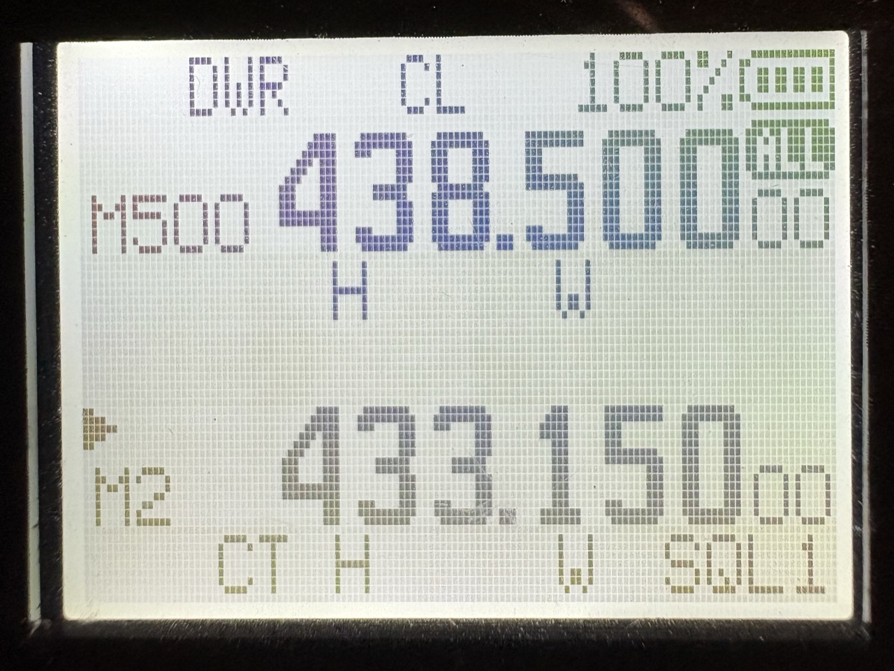
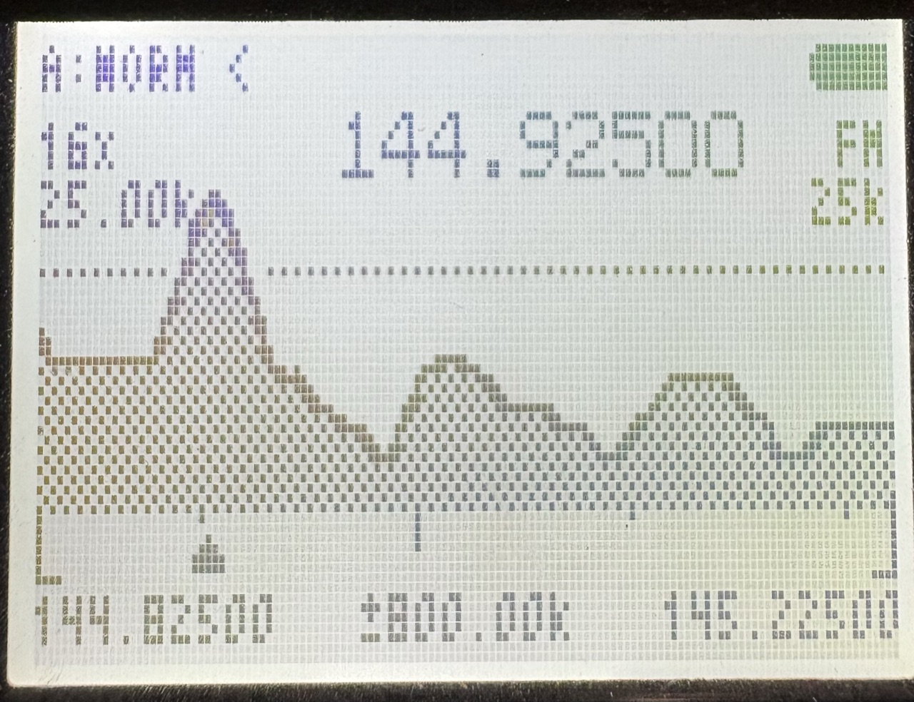
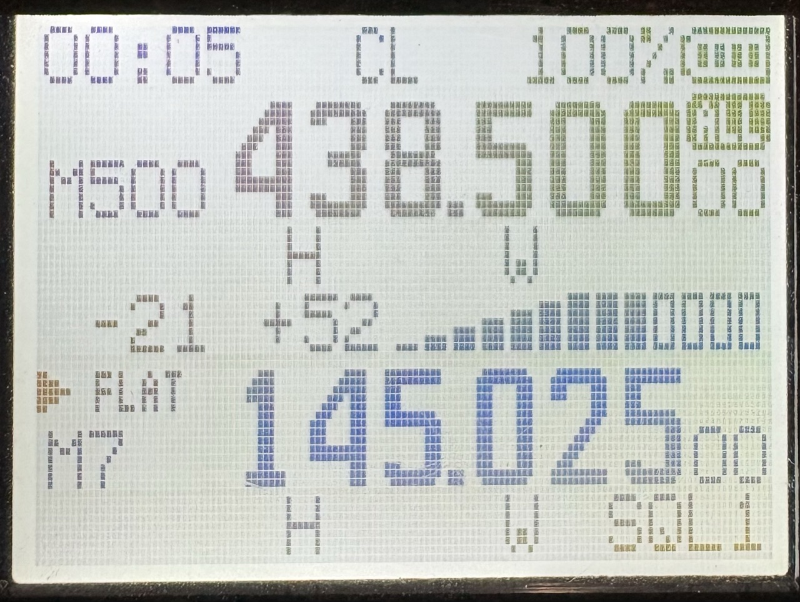
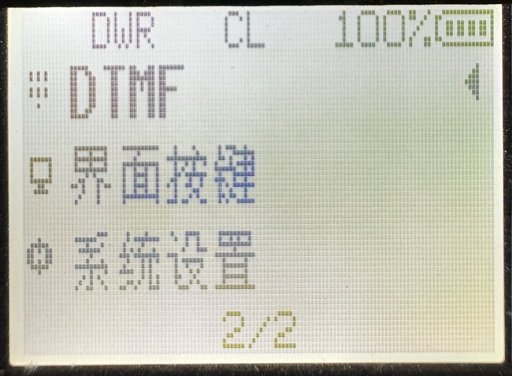
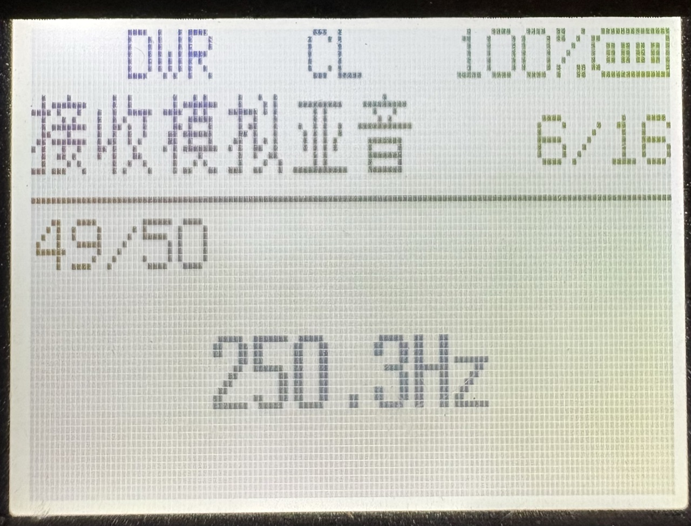
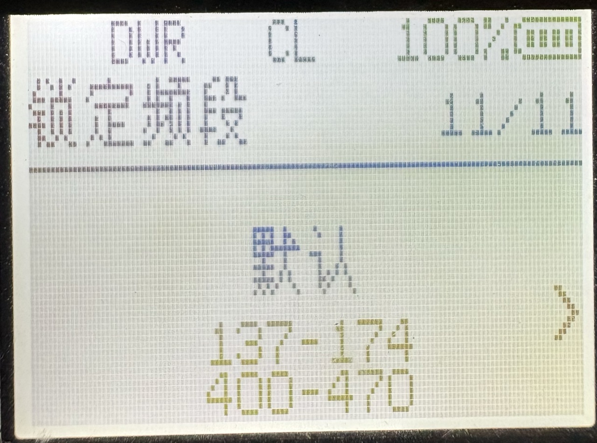

# 八荒固件 · Bahuang Firmware

> 专为泉盛 UV-K6 V3 / UV-K1 / UV-K1(8) 打造的中文自定义固件

---

## 📸 实机截图

<table>
  <tr>
    <td align="center"><br>双 VFO 主界面</td>
    <td align="center"><br>频谱分析仪（F + 5）</td>
  </tr>
  <tr>
    <td align="center"><br>接收中：信号强度与 S 表</td>
    <td align="center"><br>强信号接收</td>
  </tr>
  <tr>
    <td align="center"><br>发射中</td>
    <td align="center"><br>拼音输入法编辑信道名</td>
  </tr>
  <tr>
    <td align="center"><br>分类菜单（1/2）</td>
    <td align="center"><br>分类菜单（2/2）</td>
  </tr>
  <tr>
    <td align="center"><br>接收模拟亚音</td>
    <td align="center"><br>锁定频段</td>
  </tr>
</table>

---

## 🧭 开发理念

八荒固件从第一性原理出发——每一项功能都必须回答：它解决了什么真实问题？如果答案模糊，就不加。继承已有固件中经过验证的设计，删去堆砌和画蛇添足，让操作逻辑回归清晰与简洁。我们的目标是通用，而不是迎合某一种使用偏好——让更多人拿起来就能用，而不是为少数人定制。

在此基础上，我们做了：菜单按功能分类折叠，以及完整的拼音输入法——为中文用户提供真正本地化的体验。我们对社区代码进行了深度的检查和审计，修复潜在的问题，优化改进算法。

**这是一个为真实使用而生的固件，不是功能展示台。**

---

## 📚 用户使用手册

详细的操作说明、菜单逐项解释、快捷键参考及常见问题，请查阅 **[Wiki 用户手册](../../wiki)**：

| Wiki 页面 | 内容 |
|-----------|------|
| [菜单参考](../../wiki/菜单参考) | 所有菜单项的取值范围与说明 |
| [快捷键参考](../../wiki/快捷键参考) | 全部 F+N 组合键与长按操作 |
| [中文字体刷写](../../wiki/中文字体刷写) | CJK 字体安装步骤 |
| [常见问题](../../wiki/常见问题) | 刷机、写频、兼容性等常见疑问 |

---

## ⚠️ 使用须知

**使用本固件的风险完全由您自行承担。**
本固件不提供任何形式的保证，不保证在您的设备上正常工作，极端情况下可能导致设备无法启动（变砖）。

> 🔴 **重要**：本固件仅适用于搭载 **PY32F071** 主控的机型（UV-K5/K6 V3 / UV-K1 / UV-K1(8)）。
> **请勿将本固件刷入旧款 UV-K5/K6 V1（DP32G030 主控），否则会直接变砖。**
> 如不确定自己的机型，请查看机器背面的型号标贴。

**强烈建议在刷机前先备份校准数据**，具体方法见[备份校准数据](#-备份和恢复校准数据)章节。

---

## 📻 支持机型

| 机型 | 主控芯片 | 是否支持 |
|------|---------|---------|
| 泉盛 UV-K5 V3 | PY32F071 | ✅ |
| 泉盛 UV-K6 V3 | PY32F071 | ✅ |
| 泉盛 UV-K1 | PY32F071 | ✅ |
| 泉盛 UV-K1(8) | PY32F071 | ✅ |
| 泉盛 UV-K5 V1 | DP32G030 | ❌ 不支持，会变砖 |
| 泉盛 UV-K6 V1 | DP32G030 | ❌ 不支持，会变砖 |

---

## ✨ 功能概览

> ✅ = 默认包含　　❌ = 默认未包含（可用 Custom 版自行编译开启）　　⚙️ = 菜单可手动开启

| 类别 | 功能 | 说明 | Default |
|------|------|------|---------|
| **接收 / 发射** | 宽频接收 | 超出业余频段的宽频接收能力 | ✅ |
| | 三档发射功率 | 低 ≈1 W / 中 ≈2 W / 高 ≈5 W（默认高） | ✅ |
| | 区域发射锁定 | FCC / CE / GB / CA | ✅ |
| | 窄带 / 超窄带 | 12.5 kHz / 6.25 kHz 切换 | ✅ |
| | AM 接收修正 | AM Fix 自动增益修正 | ✅ |
| | CTCSS / DCS | 亚音 / 数字静噪扫描与编码 | ✅ |
| **信道管理** | 999 信道存储 | 手动输入或 CHIRP 写频 | ✅ |
| | 信道名编辑 | 支持英文 / 中文拼音输入，最多 10 显示格 | ✅ |
| | 信道内直接编辑 | 信道模式下修改亚音、频差、宽窄带、功率等，确认后直接保存到当前信道，切换信道不会丢失 | ✅ |
| | 24 扫描列表 | 每条信道可分配至指定列表或全局扫描 | ✅ |
| | 极速扫描 | ≈150 个频率 / 秒 | ✅ |
| | 频率排除 | 扫描时跳过已标记频率 | ✅ |
| | 开机状态恢复 | 自动恢复上次扫描 / 频谱 / FM 状态 | ✅ |
| | AirCopy | 通过无线电波无线克隆信道数据（开机时按住 PTT + 侧键 2 进入），界面支持中文 | ✅ |
| **频谱分析仪** | 一键开启 | **F + 5** 启动，显示当前频率附近活动分布 | ✅ |
| | 信道名叠加 | 锁定活跃频率并显示信道名 | ✅ |
| | 参数保存 | 频谱参数可持久化 | ✅ |
| **FM 收音机** | FM 广播接收 | 76–108 MHz，最多存储 20 个电台 | ✅ |
| | 自动搜台 | 一键扫描全波段 | ✅ |
| **界面 / 显示** | 中文界面 | 开机画面、主界面、菜单、系统信息、扫描、AirCopy 等中文显示（需刷中文字体） | ✅ |
| | S 表样式 | 经典 / 精简（符合 IARU 一区 R.1 建议） | ✅ |
| | 屏幕模式 | 单 VFO / 双 VFO / 交叉显示 | ✅ |
| | 背光控制 | 亮度调节 + 渐变淡出 | ✅ |
| | 屏幕对比度 | 0–15 可调 | ✅ |
| | 屏幕翻转 | 180° 旋转显示 | ✅ |
| | 状态栏 | 电量 / 电压、PTT 模式、RX/TX 计时器、USB 图标 | ✅ |
| | 音频示波器 | TX 时显示音频波形（默认显示麦克风电平条） | ❌ |
| | 截图导出 | 通过 USB 串口导出屏幕（配合 K5Viewer） | ❌ |
| **输入法** | 中文拼音 IME | 拼音联想候选字，配合 CJK 字体使用 | ✅ |
| **其他** | VOX | 声控发射 | ⚙️ |
| | DTMF | 拨号音发射 | ⚙️ |
| | 省电休眠 | 无操作自动深度休眠（1 min – 2 h 可调） | ✅ |
| | BEAM | 紧急信令发射 | ❌ |

### ⌨️ 快捷键

| 按键组合 | 功能 |
|---------|------|
| **F + 0** | 开启 FM 收音机 |
| **F + 1** | 切换频段（VFO 模式下） |
| **F + 2** | 切换 VFO A / B |
| **F + 3** | 切换 VFO 模式（频率 ↔ 信道） |
| **F + 4** | 启动频率扫描仪 |
| **F + 5** | 开启频谱分析仪 |
| **F + 6** | 切换发射功率 |
| **F + 7** | VOX 开关 |
| **F + 8** | 临时切换最大背光亮度 |
| **F + 9** | 恢复自动背光策略 |
| **F + \*** | CTCSS / DCS 亚音扫描 |
| **F + ↑ / ↓** | 动态调整静噪等级 |
| **长按 MENU**（扫描中） | 排除当前信道 |
| **长按 EXIT** | 恢复完整 VFO 状态 |
| **开机时按住 PTT + 侧键 2** | 进入 AirCopy 无线克隆 |

---

## 🚀 刷机指南

> 刷机不需要安装任何软件，用浏览器即可完成（需 Chrome 或 Edge）。

### 第一步：备份校准数据（强烈建议）

> 校准数据存储着对讲机出厂频率校准信息，丢失后将影响发射频率准确度，**请务必在刷机前备份**。

1. 将对讲机**正常开机**后，用 USB 数据线连接电脑
2. 用 **Chrome 或 Edge 浏览器**打开 [uvtools2](https://armel.github.io/uvtools2/?mode=dump)，切换到 **Dump** 标签
3. 点击 `Dump Calibration Data`，选择串口
4. 完成后点击 `Download calibration.dat` 保存到电脑
5. 建议用对讲机序列号重命名文件（序列号在电池仓背面标签上）

### 第二步：下载固件

前往 [Releases 页面](../../releases) 下载最新版本的固件文件：

| 文件 | 用途 |
|------|------|
| `bahuang-vX.Y.Z-default.bin` | 固件 |
| `cjk_font.bin` | 中文字体（第五步使用，只需刷一次） |

> 固件和 `cjk_font.bin` 请从**同一个 Release** 下载，字体需要覆盖该版本固件用到的全部汉字。

> **版本说明**
>
> | 版本 | 适合人群 | 说明 |
> |------|---------|------|
> | **Default** | 所有用户 | 完整功能集：频谱、FM、VOX、音频调节、扫描加速、AirCopy 等，发布的固件就是这个版本 |
> | **Custom** | 开发者 | 继承 Default，需要自己编译，可开启游戏、截图、BEAM、救援操作等额外功能 |
>
> **曾经使用 Full 版的用户**：Full 版已停止发布，请改刷 Default。刷完后请检查锁定频段设置（Full 里的“禁止全部”和“解锁全部”的编号与 Default 不同，可能被当成默认频段，即可以发射）；Full 的菜单锁和按键设置也会被清除。

### 第三步：进入 DFU 刷机模式

适用所有机型（UV-K6 V3 / UV-K1 / UV-K1(8)）：

1. 按住 **PTT 键**不放
2. 拨动**电源开关**开机
3. 顶部 LED 灯亮起，表示已进入 DFU 模式
4. 此时再插入 USB 线，即可开始刷机

> 请使用**能传输数据**的 USB 线，只能充电的线电脑识别不到对讲机。

### 第四步：刷入固件

1. 用 **Chrome 或 Edge 浏览器**打开 [uvtools2](https://armel.github.io/uvtools2/?mode=flash)，切换到 **Flash** 标签
2. 选择下载好的 `.bin` 固件文件
3. 点击 `Flash Firmware`，选择对讲机对应的串口
4. 等待进度条走完，**期间不要拔线或断电**
5. 对讲机自动重启，加载新固件完成 ✅

> 刚刷完、还没刷字体时，界面是**英文**，这是正常的，继续第五步。

### 第五步：刷写中文字体（中文用户必做）

> 汉字字库不在固件里，而是存放在对讲机的 SPI Flash 中，需要单独刷写一次。刷完并重启后，界面会自动变成中文。

**前提**：已完成第四步，对讲机里运行的是八荒固件。

1. 对讲机**正常开机**（不要按 PTT，不要进 DFU 模式），用 USB 数据线连接电脑。如果电脑上开着 CHIRP 等会占用串口的软件，请先关闭
2. 用 **Chrome / Edge** 打开 **[https://hyggx.github.io/bahuang-firmware/](https://hyggx.github.io/bahuang-firmware/)**
3. **第一步**：选择 Releases 里下载的 `cjk_font.bin`，页面会检查文件是否有效
4. **第二步**：点击 `连接串口`，选择对讲机对应的串口。连接成功后页面显示 `已连接` 和固件版本（如 `v0.2.0`）
5. **第三步**：保持勾选 `写入后校验`，点击 `开始刷写`，等待进度条走完，**期间不要拔线**
6. 日志出现 `CJK 字体已成功写入 SPI Flash`，即表示写入并校验通过
7. **关机再开机**，界面即为中文

如果重启后仍是英文，在菜单 **System（系统设置）→ Lang（语言）** 里选择 `ZH`。

> **提示**：
> - 字体存储在 SPI Flash，固件升级和恢复出厂都不会清除它，**只需刷一次**。
> - 刷写失败可以直接重试，不会影响已刷入的固件。
> - 如需使用 Python 脚本手动刷写，请参阅 [Wiki：Python 脚本刷字体](../../wiki/CJK-Font-Flash-Python)。

---

## 💾 备份和恢复校准数据

### 备份

1. 对讲机**正常开机**，连接 USB 数据线
2. 打开 [uvtools2](https://armel.github.io/uvtools2/?mode=dump)，切换到 **Dump** 标签
3. 点击 `Dump Calibration Data` → 选串口 → 下载 `calibration.dat`

### 恢复

1. 对讲机**正常开机**，连接 USB 数据线
2. 打开 [uvtools2](https://armel.github.io/uvtools2/?mode=restore)，切换到 **Restore** 标签
3. 选择之前保存的 `calibration.dat` 文件
4. 点击 `Restore Calibration Data`，等待完成

---

## 📖 菜单说明

以下为菜单分类速览。每项参数的取值范围与使用建议，请查阅 **[Wiki › 菜单参考](../../wiki/菜单参考)**。

| 类别 | 主要设置项 |
|------|----------|
| **接收设置** | 静噪等级、步进、带宽、AM Fix、RX 频率偏移 |
| **发射设置** | 发射功率、CTCSS / DCS 编码、区域发射锁定 |
| **信道管理** | 写入信道、删除信道、编辑信道名、扫描列表分配 |
| **扫描** | 扫描模式、暂留时间、恢复条件、频率排除 |
| **显示 / 界面** | 背光亮度 / 时长、对比度、S 表样式、屏幕翻转 |
| **省电 / 系统** | 休眠时间、按键音、VOX、DTMF |
| **FM 收音机** | 频率、电台存储、自动搜台 |

> **信道模式下的修改会直接保存**：在信道（MR）模式下改亚音、频差、宽窄带、遇忙锁定、发射功率等，菜单确认后立即写入当前信道，切换信道再回来依然有效，不需要再用"存储信道"覆盖。

---

## ❓ 常见问题

**Q：刷完固件是英文界面？**
A：正常。汉字字库需要单独刷写，请按[第五步](#第五步刷写中文字体中文用户必做)刷入 `cjk_font.bin`，重启后自动变为中文。

**Q：刷字体时连接串口失败，或没有显示固件版本？**
A：请确认：对讲机是**正常开机**（不是 DFU 模式）、已刷入八荒固件、使用的是数据线、浏览器是 Chrome / Edge、CHIRP 等软件没有占用串口。

**Q：中文显示空白或缺字？**
A：字体没刷完或版本不对。请从与固件相同的 Release 下载 `cjk_font.bin`，重新刷写一次。

**Q：刷机后对讲机无法开机？**
A：请先尝试恢复校准数据。若问题持续，请在 [Issues](../../issues) 页面反馈。

**Q：刷机后发射频率偏移？**
A：通常是校准数据未恢复导致。请重新恢复备份的 `calibration.dat`。

**Q：如何写频（编程信道）？**
A：可以用 **F + 4** 频率扫描仪扫到频率后保存，或在菜单中手动输入、存储信道。Releases 页面目前不提供 CHIRP 驱动。

**Q：我的 UV-K5 旧款能刷吗？**
A：**不能。** 旧款 UV-K5（V1）使用 DP32G030 主控，与本固件不兼容，刷入会变砖。

**Q：这个固件是否合法？**
A：固件本身是合法的开源软件。发射行为是否合法取决于您当地的无线电法规及您是否持有相应许可证。请遵守当地法律法规。

> 更多问题请查阅 **[Wiki › 常见问题](../../wiki/常见问题)**。

---

## 🔧 开发者：从源码编译

> 本章节面向开发者，普通用户无需阅读。

### 使用 Docker（推荐）

```bash
git clone git@github.com:hyggx/bahuang-firmware.git
cd bahuang-firmware

./compile-with-docker.sh Default   # 发布版
./compile-with-docker.sh Custom    # 自定义版（可开启额外功能）
```

### 本机编译（需 `arm-none-eabi-gcc` + CMake）

```bash
cmake --preset Default
cmake --build --preset Default -j
```

输出文件位于 `build/<Preset>/`，包含 `.elf`、`.bin`、`.hex`。

**功能开关**：在 `CMakePresets.json` 的 `Custom` Preset 中修改 `cacheVariables`，修改后需清空 `build/Custom/` 目录并重新运行 `cmake --preset Custom`。

---

## 🙏 致谢

本固件站在众多开发者的肩膀上：

- [DualTachyon](https://github.com/DualTachyon) — 泉盛 UV-K5 开源固件的奠基人
- [Egzumer](https://github.com/egzumer) — 大量基础功能增强
- [OneOfEleven](https://github.com/OneOfEleven) — 诸多核心改进
- [armel (F4HWN)](https://github.com/armel) — UV-K1/K5 V3 PY32F071 适配
- [muzkr](https://github.com/muzkr) — PY32F071 驱动开发
- [fagci (Mikhail)](https://github.com/fagci) — 频谱分析仪
- [Dondji](https://github.com/EthanYan6/Dondji) — 拼音码点表

---

## 📄 许可证

Copyright 2023 Dual Tachyon  
Copyright 2025–2026 [hyggx](https://github.com/hyggx) and Bahuang Firmware Contributors  
基于 [Apache License 2.0](LICENSE) 开源协议发布。

如果您基于本项目创建派生版本，鼓励您保持开源，与社区共享您的工作。